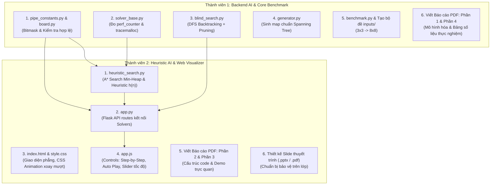

# Kế hoạch chi tiết & Kiến trúc Đồ án AI: Puzzle Pipes Solver (Flask + Web Visualizer)

> **Môn học:** Trí tuệ Nhân tạo (Intro to AI) - Trường ĐH Bách Khoa ĐHQG-HCM (BKU)  
> **Đề tài:** Logic Puzzle - Game **Pipes** (https://www.puzzle-pipes.com/)  
> **Ngôn ngữ:** Python 3.10+ (Core Solver: thư viện chuẩn; Web Server: `flask`)  
> **Giao diện:** HTML5 + CSS3 (Animation xoay mượt mà & hiệu ứng nước chảy) + Vanilla JavaScript  
> **Quy mô:** Nhóm 2 thành viên (50% - 50%)  

---

## 1. Tổng quan Kiến trúc Hệ thống (System Architecture)

Hệ thống được thiết kế theo mô hình **Client - Server cục bộ (Local Web App)** tách biệt hoàn toàn giữa giải thuật AI và tầng hiển thị:

```mermaid
flowchart LR
    subgraph Frontend ["Frontend (HTML5 / CSS3 / Vanilla JS)"]
        UI["Web UI Canvas<br/>(Lưới ống nước, Hiệu ứng xoay, Nước chảy)"]
        CTRL["Controls<br/>(Step-by-Step, Auto Play, Slider tốc độ, Random Map)"]
        HUD["Bảng thông số thời gian thực<br/>(Time ms, RAM KB, Số node duyệt)"]
    end

    subgraph Backend ["Backend Python (Flask API Server)"]
        API["app.py (Flask Routes)"]
        SOLVER["Solvers Engine<br/>(DFS Backtracking & A* Search)"]
        MEASURE["Bộ đo chuẩn<br/>(perf_counter & tracemalloc)"]
        GEN["generator.py<br/>(Spanning Tree Map Generator)"]
    end

    CTRL -->|1. POST /api/solve (algorithm, board)| API
    CTRL -->|POST /api/generate (size)| API
    API --> SOLVER
    API --> GEN
    SOLVER --> MEASURE
    MEASURE -->|2. Trả về JSON (steps, time_ms, memory_kb)| UI
    UI --> HUD
```

### Ưu điểm vượt trội của kiến trúc này:
1. **Tuân thủ 100% quy định đề bài:** Toàn bộ thuật toán tìm kiếm DFS, $A^*$ và đo đạc được viết thuần túy bằng Python 3.
2. **Trải nghiệm trực quan đỉnh cao (Điểm A thuyết trình):** CSS Animation xoay ống $90^\circ$ mượt mà, đổi màu xanh ngọc phát sáng khi thông mạch.
3. **Cài đặt cực nhanh khi nộp bài:** Người chấm chỉ cần gõ đúng 1 lệnh `python app.py` (hoặc `python main.py`) là trình duyệt tự mở.
4. **Hai người làm việc song song không nghẽn:** Nhờ chuẩn hóa định dạng JSON giao tiếp giữa Backend và Frontend, người làm thuật toán và người làm web có thể code độc lập ngay từ ngày đầu tiên.

---

## 2. Cấu trúc thư mục chuẩn (Project Directory Structure)

```text
puzzle-pipes-ai/
├── inputs/                         # Bộ dữ liệu test cases cố định (dạng Level)
│   ├── level_3x3_easy.txt          # Dành cho chụp ảnh demo từng bước
│   ├── level_4x4_easy.txt
│   ├── level_5x5_medium.txt
│   ├── level_6x6_medium.txt
│   ├── level_7x7_hard.txt
│   └── level_8x8_hard.txt
├── outputs/                        # Thư mục xuất dữ liệu thực nghiệm
│   └── benchmark_results.csv       # File CSV bảng số liệu phục vụ Báo cáo
├── src/
│   ├── __init__.py
│   ├── pipe_constants.py           # Bitmask 4 hướng (N, E, S, W) và phép xoay tròn bit
│   ├── board.py                    # Khởi tạo bảng, kiểm tra khớp láng giềng, check liên thông BFS
│   ├── solver_base.py              # Class cha chuẩn hóa: đo time_perf, tracemalloc, ghi log steps
│   ├── blind_search.py             # Giải thuật DFS Backtracking + Cắt tỉa nhánh (Forward Pruning)
│   ├── heuristic_search.py         # Giải thuật A* với Min-Heap (heapq) và Heuristic h(n)
│   ├── generator.py                # Thuật toán sinh bàn cờ ngẫu nhiên 100% có nghiệm (Spanning Tree)
│   └── benchmark.py                # Script chạy tự động tất cả testcase, đo đạc xuất CSV
├── templates/
│   └── index.html                  # Giao diện Web Visualizer chính
├── static/
│   ├── css/
│   │   └── style.css               # Giao diện hiện đại, animation xoay ống & hiệu ứng nước
│   └── js/
│       └── app.js                  # Logic render lưới, animation step-by-step, fetch API
├── app.py                          # Flask Server: phục vụ Web UI và các API endpoints
├── main.py                         # Entry point: tùy chọn chạy Web UI hoặc chạy Benchmark CLI
├── requirements.txt                # Chỉ gồm: flask
├── README.md                       # Hướng dẫn cài đặt và chạy chương trình
└── plan.md                         # Bảng kế hoạch chi tiết và tiến độ dự án
```

---

## 3. Đặc tả API giao tiếp giữa Backend và Frontend (JSON Contract)

Chuẩn JSON này giúp hai thành viên bắt tay vào làm việc ngay mà không phụ thuộc lẫn nhau:

### 3.1. API Giải bài toán: `POST /api/solve`
- **Request Body gửi lên:**
```json
{
  "algorithm": "astar",          // "dfs" hoặc "astar"
  "board": [
    [3, 6, 12],
    [5, 10, 5],
    [9, 6, 12]
  ]                              // Ma trận số nguyên bitmask của từng ô
}
```
- **Response trả về:**
```json
{
  "success": true,
  "algorithm": "astar",
  "time_ms": 12.45,
  "memory_kb": 184.2,
  "nodes_explored": 142,
  "final_board": [[...]],
  "steps": [
    { "step": 1, "r": 0, "c": 0, "old_mask": 3, "new_mask": 6, "angle": 90 },
    { "step": 2, "r": 0, "c": 1, "old_mask": 6, "new_mask": 12, "angle": 180 },
    { "step": 3, "r": 0, "c": 1, "action": "backtrack", "old_mask": 12, "new_mask": 6 }
  ]
}
```

### 3.2. API Lấy danh sách Level: `GET /api/levels`
- Trả về danh sách tên các file có sẵn trong thư mục `inputs/` (`level_3x3_easy.txt`, `level_4x4_easy.txt`,...).

### 3.3. API Sinh bàn cờ ngẫu nhiên: `POST /api/generate`
- **Request:** `{ "size": 5 }`
- **Response:** `{ "board": [[...]], "size": 5 }` (Đảm bảo 100% có nghiệm nhờ thuật toán sinh cây khung).

---

## 4. Phân công công việc cho 2 thành viên (50% - 50%)



| Tiêu chí | Thành viên 1 (Backend AI & Benchmark) | Thành viên 2 (Heuristic & Web Frontend) |
| :--- | :--- | :--- |
| **Logic & Thuật toán** | - Xây dựng Bitmask 4 hướng trong `pipe_constants.py`.<br>- Viết `board.py` (Parser nạp file, xoay ô, check khớp biên láng giềng, check liên thông bằng BFS).<br>- Viết `solver_base.py` (chuẩn hóa đo `time.perf_counter()` và `tracemalloc`).<br>- Viết `blind_search.py` (**DFS Backtracking** với kỹ thuật cắt tỉa tức thời Forward Pruning). | - Viết `heuristic_search.py` (**Thuật toán $A^*$** dùng `heapq`).<br>- Thiết kế hàm Heuristic $h(n)$ (Admissible: đếm số cổng bị xung đột / hở biên chia cho 2).<br>- Tối ưu cấu trúc lưu vết trạng thái `steps` để truyền dữ liệu nhẹ nhất sang Frontend. |
| **Công cụ & Giao diện** | - Viết `generator.py` (sinh map ngẫu nhiên 100% có nghiệm bằng Cây khung ngẫu nhiên).<br>- Viết `benchmark.py` tự động chạy 6-8 testcases từ 3x3 đến 8x8, xuất `benchmark_results.csv`. | - Viết `app.py` (Flask server nối API `/api/solve`, `/api/generate`, `/api/levels`).<br>- Xây dựng Web UI (`index.html`, `style.css`, `app.js`):<br>  + Vẽ lưới ống nước hiện đại, hiệu ứng xoay $90^\circ$ mượt mà.<br>  + Nút điều khiển: **Step Next**, **Step Back**, **Auto Play**, **Pause**, **Tua nhanh/chậm**.<br>  + Bảng HUD: Hiển thị Time (ms), RAM (KB), Nodes explored. |
| **Báo cáo & Thuyết trình** | - Viết **Phần 1 Báo cáo PDF**: Mô tả bài toán & Mô hình hóa (State, Action, Goal Test, Bitmask).<br>- Viết **Phần 4 Báo cáo PDF**: Bảng số liệu thực nghiệm, vẽ biểu đồ so sánh, phân tích chuyên sâu nguyên nhân chênh lệch thời gian & RAM. | - Viết **Phần 2 Báo cáo PDF**: Cấu trúc mã nguồn, phân tích nguyên lý DFS vs $A^*$, chứng minh tính Admissible của $h(n)$.<br>- Viết **Phần 3 Báo cáo PDF**: Chụp ảnh màn hình giao diện Web demo step-by-step.<br>- Thiết kế **Slide thuyết trình** chuyên nghiệp cho buổi bảo vệ trên lớp. |

---

## 5. Lộ trình triển khai 5 Giai đoạn (Timeline 10 - 12 ngày)

- **Giai đoạn 1 (Ngày 1 - 2): Thiết lập nền tảng & Core Data Models**
  - Cài đặt môi trường (`pip install flask`).
  - Hoàn thiện `pipe_constants.py`, `board.py`, `solver_base.py`.
  - Thành viên 2 dựng khung Flask `app.py` và giao diện HTML cơ bản.
- **Giai đoạn 2 (Ngày 3 - 5): Hiện thực 2 Thuật toán AI**
  - Thành viên 1 hoàn thiện `blind_search.py` (DFS).
  - Thành viên 2 hoàn thiện `heuristic_search.py` ($A^*$).
  - Viết `generator.py` để sinh bàn cờ ngẫu nhiên có nghiệm.
  - Test chéo kết quả giữa 2 thuật toán trên map 3x3 và 4x4.
- **Giai đoạn 3 (Ngày 6 - 7): Hoàn thiện Web Visualizer Step-by-Step**
  - Hoàn thiện hiệu ứng CSS xoay ống và đổi màu nước trên giao diện web.
  - Tích hợp các nút điều khiển: Step Forward, Step Backward, Auto-Play, Thanh trượt tốc độ.
  - Tích hợp nút chọn Level có sẵn và nút "🎲 Sinh map ngẫu nhiên".
- **Giai đoạn 4 (Ngày 8 - 9): Chạy Benchmark & Thu thập dữ liệu**
  - Chạy `benchmark.py` trên bộ testcases $3\times3, 4\times4, 5\times5, 6\times6, 7\times7, 8\times8$.
  - Thu thập bảng số liệu thời gian (ms), bộ nhớ đỉnh (KB), số node đã duyệt.
  - Xuất ra file `outputs/benchmark_results.csv` và vẽ biểu đồ so sánh.
- **Giai đoạn 5 (Ngày 10 - 12): Hoàn thiện Báo cáo PDF & Slide**
  - Ghép và hoàn thiện file Báo cáo PDF 4 phần theo quy chuẩn.
  - Thiết kế slide thuyết trình tóm tắt các điểm nổi bật của nhóm.
  - Hoàn thiện file `README.md` (hướng dẫn chạy bằng 1 lệnh duy nhất).
  - Đóng gói toàn bộ thành file `.zip` theo yêu cầu của thầy.

---

## 6. Dàn ý chi tiết Báo cáo PDF (Report Outline)

Báo cáo PDF sẽ bám sát 4 phần theo đúng yêu cầu đề bài:

### Trang bìa & Thông tin chung
- Trường ĐH Bách Khoa - ĐHQG TP.HCM, Khoa KH&KT Máy tính.
- Đề tài: **Ứng dụng Giải thuật Blind Search (DFS) và Heuristic Search (A*) trong trò chơi Puzzle Pipes**.
- Bảng phân công 2 thành viên, tỉ lệ đóng góp 50% - 50%.

### Phần 1: Mô tả bài toán và mô hình hóa bài toán
1. **Mô tả trò chơi:** Giới thiệu game Puzzle Pipes trên `puzzle-pipes.com`, các loại mảnh ống, mục tiêu trò chơi.
2. **Mô hình hóa bài toán Tìm kiếm (State Space Search):**
   - **State (Trạng thái):** Ma trận góc quay của $N \times N$ ô trong lưới.
   - **Initial State (Trạng thái ban đầu):** Cấu hình bàn cờ đọc từ file input `.txt`.
   - **Actions / Legal Moves (Hành động hợp lệ):** Thao tác xoay mảnh ống tại ô $(r, c)$ theo các góc $90^\circ, 180^\circ, 270^\circ$.
   - **Goal State & Goal Test (Kiểm tra đích):**
     1. Khớp biên cục bộ (Local Consistency): Mọi cổng tiếp giáp giữa 2 ô liền kề phải khớp nhau. Cạnh biên không có cổng hướng ra ngoài tường.
     2. Liên thông toàn phần (Global Connectivity): Thuật toán BFS kiểm tra toàn bộ các đoạn ống tạo thành duy nhất 1 thành phần liên thông (Spanning Tree không chu trình).
3. **Mô tả dữ liệu input và Biểu diễn Bitmask:**
   - Cấu trúc file `.txt` đầu vào.
   - Kỹ thuật biểu diễn 4 hướng bằng bitmask 4-bit `0bW S E N` (tối ưu tốc độ xoay và tiết kiệm bộ nhớ).

### Phần 2: Cấu trúc code và giải thuật
1. **Kiến trúc tổng thể hệ thống:** Sơ đồ tương tác giữa Backend Python, Bộ Solvers, Flask API và Giao diện Web.
2. **Giải thuật Blind Search (DFS + Backtracking):**
   - Cấu trúc dữ liệu: Call Stack đệ quy.
   - Cơ chế cắt tỉa (Forward Pruning): Ngay khi gán hướng cho ô $(r, c)$, kiểm tra ngay tính tương thích với ô phía trên $(r-1, c)$ và ô bên trái $(r, c-1)$. Loại bỏ nhánh vi phạm ngay lập tức mà không cần duyệt sâu.
3. **Giải thuật Heuristic Search ($A^*$):**
   - Cấu trúc dữ liệu: Hàng đợi ưu tiên (Priority Queue / Min-Heap qua `heapq`).
   - Hàm đánh giá $f(n) = g(n) + h(n)$:
     - $g(n)$: Số bước xoay / số ô đã được cố định hướng.
     - $h(n) = \frac{\text{Số cổng lỗi}}{2}$: Hàm ước lượng số cổng tiếp giáp còn xung đột hoặc hở biên.
     - Chứng minh tính hợp lệ (Admissible) của hàm Heuristic.
4. **Cơ chế đo đạc thực nghiệm chuẩn xác:**
   - Đo thời gian CPU/Wall-clock: `time.perf_counter()`.
   - Đo đỉnh bộ nhớ RAM: `tracemalloc.get_traced_memory()[1]`.

### Phần 3: Demo trực quan (Visual Web Demo)
1. **Thiết kế Giao diện Web Visualizer:**
   - Bảng cờ hiển thị lưới ống nước trực quan, animation xoay mượt mà, đổi màu khi kết nối thành công.
   - Bộ điều khiển: Next Step, Previous Step, Auto Play, Pause, Speed Slider, nút Sinh bàn cờ ngẫu nhiên.
2. **Minh họa Step-by-Step:**
   - Chụp chuỗi ảnh các bước giải của DFS: thể hiện rõ cơ chế duyệt sâu và quay lui (Backtracking) khi gặp ngõ cụt.
   - Chụp chuỗi ảnh các bước giải của $A^*$: thể hiện rõ thứ tự mở rộng các trạng thái có $f(n)$ nhỏ nhất.
3. **So sánh trực quan trên bàn cờ mẫu nhỏ ($4 \times 4$):** Nhận xét sự khác biệt về quỹ đạo tìm kiếm giữa 2 thuật toán.

### Phần 4: Bảng số liệu thực nghiệm và Đánh giá
1. **Bảng số liệu thực nghiệm tổng hợp:**
   - Ma trận kích thước từ $3 \times 3$ đến $8 \times 8$.
   - Các cột: Kích thước | Thuật toán | Thời gian (ms) | Bộ nhớ tiêu thụ đỉnh (KB) | Số node đã duyệt | Kết quả.
2. **Biểu đồ so sánh:** Biểu đồ cột thể hiện tương quan Thời gian và Bộ nhớ giữa DFS và $A^*$.
3. **Phân tích và nhận xét chuyên sâu:**
   - Tại sao DFS Backtracking khi có Forward Pruning lại chạy cực nhanh và tốn rất ít RAM?
   - Tại sao $A^*$ tìm được đường đi tối ưu về lý thuyết nhưng lại tốn nhiều bộ nhớ hơn khi ma trận lớn (do tập `Open Set` trong Heap phình to)?
   - Kết luận về ưu thế và phạm vi áp dụng thực tế của từng giải thuật.

---

## 7. Checklist Nộp bài (Đảm bảo 100% trọn vẹn điểm)
- [ ] Mã nguồn Python 3 chạy ổn định, chỉ cần cài `flask`.
- [ ] Chạy `python app.py` mở được Web Visualizer mượt mà, đầy đủ các nút bấm.
- [ ] Chạy `python src/benchmark.py` xuất ra file `outputs/benchmark_results.csv`.
- [ ] 1 File Báo cáo `.pdf` theo chuẩn BKU với đầy đủ 4 phần.
- [ ] 1 File Slide thuyết trình `.pptx` hoặc `.pdf`.
- [ ] File `README.md` hướng dẫn cài đặt và chạy trong 1 nốt nhạc.
- [ ] Nén toàn bộ vào 1 file `.zip` nộp lên LMS đúng hạn.
